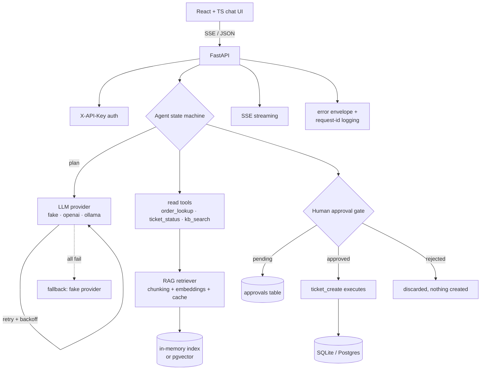

# Agentic Support Copilot

An AI support agent that doesn't just chat — it **acts** via tools, with a **human-in-the-loop approval gate** on every write action. Ask "Where is my order ORD-1002?" and it looks it up. Ask for a refund and it *drafts* the ticket, waits for your approval, and only then executes.

**Live demo:** *(URL added after deployment — see Deployment)*

> **Demo mode:** the public demo runs on a deterministic built-in provider (no API key, no external calls).
> It demonstrates the full agent loop — routing, tools, approvals, streaming, RAG — with byte-identical results on every run. Set `LLM_PROVIDER=openai|ollama` for the real LLM path.

## Architecture



**Request flow** for one chat turn:

1. `POST /api/chat` → request-ID middleware attaches `X-Request-ID`, structured log line per request.
2. Provider **plans** (tool + args) with exponential-backoff retries; on repeated failure it falls back to the fake provider; if everything fails → `503 PROVIDER_UNAVAILABLE` envelope (never a stack trace).
3. Read tools execute immediately; `ticket_create` only **stages** a pending approval — the ticket is never created at this point.
4. Provider **composes** the reply from tool results + retrieved KB snippets (with `[DOC-ID]` citations).
5. `POST /api/chat/stream` streams the same result as SSE (`meta` → `token…` → `done`).

## Features

- **LLM provider abstraction** — `fake` (deterministic, offline), `openai` (Chat Completions, httpx), `ollama` (local `/api/chat`). Swap via `LLM_PROVIDER`.
- **RAG knowledge base** — 6 seeded support docs → sliding-window chunks → embeddings (fake 128-dim hash embeddings offline, OpenAI embeddings in prod) → cosine retrieval with citations.
- **Tools** — `order_lookup`, `ticket_status`, `kb_search` (read, instant); `ticket_create` (write, **always gated**).
- **Human-in-the-loop** — write actions create `pending` approvals; `approve` executes exactly once, `reject` discards; double-resolve → `409`; UI shows an approval panel.
- **Streaming** — SSE endpoint with meta/token/done events.
- **Auth** — `X-API-Key` header on all `/api` routes (`/health`, `/ready` public).
- **Evals** — 24-case golden set, offline, deterministic.
- **Error envelope** — every error is `{"error": {"code", "message", "request_id"}}`; `/ready` reports provider + cache health.

## Quickstart

### Local (no Docker, no keys)

```bash
cd agentic-support-copilot
python3 -m venv .venv && .venv/bin/pip install -r backend/requirements.txt
API_KEY=demo-key LLM_PROVIDER=fake .venv/bin/python -m uvicorn app.main:app \
  --app-dir backend --host 127.0.0.1 --port 8000
# UI + API at http://127.0.0.1:8000  (API key: demo-key)
```

### Docker Compose (Postgres + pgvector path)

```bash
# build the frontend first (backend serves it from backend/static)
cd frontend && npm ci && VITE_DEMO_MODE=true npx vite build && cp -r dist ../backend/static && cd ..
docker compose up --build
# http://localhost:8000
```

### Run tests & evals

```bash
.venv/bin/python -m pytest tests/ -q
PYTHONPATH=backend .venv/bin/python evals/run_evals.py
.venv/bin/python scripts/bench.py --requests 60
```

## API reference

All `/api` routes require `X-API-Key` (default `demo-key`).

| Method | Path | Description |
|---|---|---|
| POST | `/api/chat` | One agent turn → `{reply, tool_calls, approval, sources, provider, request_id}` |
| POST | `/api/chat/stream` | Same turn as SSE (`meta`, `token`, `done` events) |
| GET | `/api/orders/{id}` | Order lookup (`ORD-1001`…`ORD-1005` seeded) |
| GET | `/api/tickets/{id}` | Ticket lookup (`TKT-2001`… seeded) |
| POST | `/api/tickets` | **Always** returns a `pending` approval (`202`), never creates directly |
| GET | `/api/approvals[?status=]` | List approvals |
| GET | `/api/approvals/{id}` | Approval detail |
| POST | `/api/approvals/{id}/approve` | Approve → staged tool executes once |
| POST | `/api/approvals/{id}/reject` | Reject → discarded |
| GET | `/api/kb/search?q=&top_k=` | KB retrieval (also returns cache stats) |
| GET | `/api/cache/stats` | Embedding + retrieval cache hit/miss |
| GET | `/health` | Liveness (no auth) |
| GET | `/ready` | Readiness: provider check + cache stats (no auth) |

Try it:

```bash
K=demo-key; B=http://127.0.0.1:8000
curl -s -H "X-API-Key: $K" -X POST $B/api/chat -H 'Content-Type: application/json' \
  -d '{"message":"Where is my order ORD-1002?"}' | python3 -m json.tool | head -20
# Refund → staged approval:
AID=$(curl -s -H "X-API-Key: $K" -X POST $B/api/chat -H 'Content-Type: application/json' \
  -d '{"message":"I want a refund for order ORD-1005"}' | python3 -c "import json,sys; print(json.load(sys.stdin)['approval']['id'])")
curl -s -H "X-API-Key: $K" -X POST $B/api/approvals/$AID/approve -H 'Content-Type: application/json' -d '{}'
```

## Error codes

| Code | HTTP | When |
|---|---|---|
| `UNAUTHORIZED` | 401 | Missing/invalid `X-API-Key` |
| `VALIDATION_ERROR` | 422 | Bad payload (FastAPI validation mapped into the envelope) |
| `ORDER_NOT_FOUND` / `TICKET_NOT_FOUND` | 404 | Unknown ID |
| `APPROVAL_NOT_FOUND` | 404 | Unknown approval ID |
| `APPROVAL_ALREADY_RESOLVED` | 409 | Approving/rejecting twice |
| `PROVIDER_UNAVAILABLE` | 503 | All LLM providers failed after retries + fallback |
| `INTERNAL_ERROR` | 500 | Unexpected error — logged server-side with traceback, client sees only the envelope + request ID |

## Error-handling design

- **One envelope everywhere**: `APIError` + handlers for validation and uncaught exceptions. Clients never see stack traces.
- **Provider resilience**: `plan_with_retry` / `compose_with_retry` do exponential backoff (`PROVIDER_MAX_RETRIES=3`, base 0.5s) against the configured provider, then fall back to the deterministic fake provider, and only then return `503 PROVIDER_UNAVAILABLE`.
- **Tool errors are recoverable**: `ORDER_NOT_FOUND` inside a chat turn doesn't 500 — the agent explains it to the user ("I couldn't find order ORD-9999…").
- **Approval safety**: the write tool's `draft()` and `execute()` are separate code paths; the agent can only call `draft()`. Double-resolve is rejected with `409`. Nothing is created on reject.
- **Observability**: every request gets `X-Request-ID` (echoed in the response header and the error envelope); structured JSON log lines (`http`, `plan_ok`, `tool_error`, `approval_staged`, `approval_resolved`, `turn_done`) carry latency_ms.

## Performance

Measured on this VM (SQLite, fake provider, `scripts/bench.py`, 60 chat requests):

| Metric | Value |
|---|---|
| Chat `POST /api/chat` p50 | **21.68 ms** |
| Chat p95 | **49.24 ms** |
| Chat mean / max | 24.83 ms / 54.31 ms |
| KB search, cold (no cache) | 15.32 ms |
| KB search, warm (cached) p50 | **4.62 ms** (~3.3× faster) |
| Retrieval cache during bench | 34 hits / 3 misses |

**What was optimized:**

1. **Async endpoints + async httpx for providers** — the event loop is never blocked on LLM I/O; DB uses pooled SQLAlchemy sessions (10 + 20 overflow, `pool_pre_ping` on Postgres).
2. **Two-level caching** — TTL caches on both embeddings (`CachedEmbeddings`) and retrieval results (`Retriever`), with observable hit/miss stats at `/api/cache/stats`. Repeated KB queries skip re-embedding entirely.
3. **Retriever index built once** at startup — chunks are embedded a single time, not per query.
4. **GZip middleware** on responses > 1 KB (helps the SSE + chat payloads).
5. **Deterministic fake embeddings** are pure-Python and dependency-free; stopword filtering keeps content words dominant so top-1 retrieval is exact on the golden set.

## Eval results

`evals/run_evals.py` — 24 golden cases, offline, deterministic (fake provider):

| Metric | Result |
|---|---|
| Tool-call accuracy | **100%** (24/24) |
| Approval-gate compliance | **100%** (6/6 — write intents staged, zero tickets created pre-approval) |
| Groundedness (KB answers cite the right doc + key phrase) | **100%** (9/9) |

Test suite: **38 passed** (`pytest tests/`) — routing, tools, approval flow, RAG + cache, API endpoints, error envelopes, provider-failure fallback.

## Deployment

- **Live demo:** *(to be added — public URL via localhost.run tunnel)*
- Runs from one process: `uvicorn app.main:app` serves the React build from `/` and the API under `/api`.
- `DEMO_MODE=true` forces the fake provider for the public demo; the UI shows a "DEMO MODE" badge.
- `docker-compose.yml` adds Postgres 16 + pgvector for the production RAG path (server-side vector search replaces the in-memory index — same `Retriever` interface).

## Trade-offs & limitations (honest)

- **No LangChain/LangGraph dependency.** The agent is an explicit state machine (`PLAN → TOOL/APPROVAL_GATE → COMPOSE`). This was a deliberate choice: the graph is small, and explicit states are easier to test, log, and put a human gate into than a framework DAG. The README never claims otherwise.
- **The fake provider is not an LLM.** It's a rule-based router + template composer. It exists so the *system* (tools, approvals, streaming, evals, UI) is fully testable offline. Real LLM quality (OpenAI/Ollama paths) is implemented but not eval-scored here — scoring a non-deterministic provider would need an LLM-judge harness, which is listed as next work.
- **pgvector path is configured, not load-tested.** The compose file wires Postgres+pgvector; the in-memory retriever is what CI and the demo exercise.
- **Auth is a shared API key**, not per-user JWT — fine for a demo, not for multi-tenant prod.
- **No persistence of provider conversation memory beyond 10 messages** per session (by design, keeps context small).

## Resume highlights

See [RESUME_BULLETS.md](RESUME_BULLETS.md) for copy-paste bullets (all metrics verified from this build).
